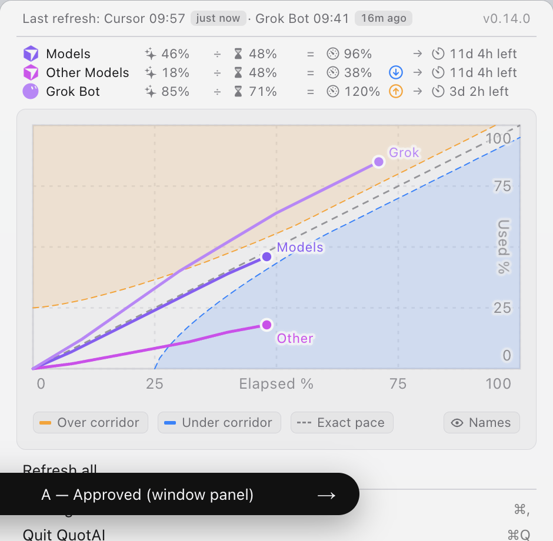
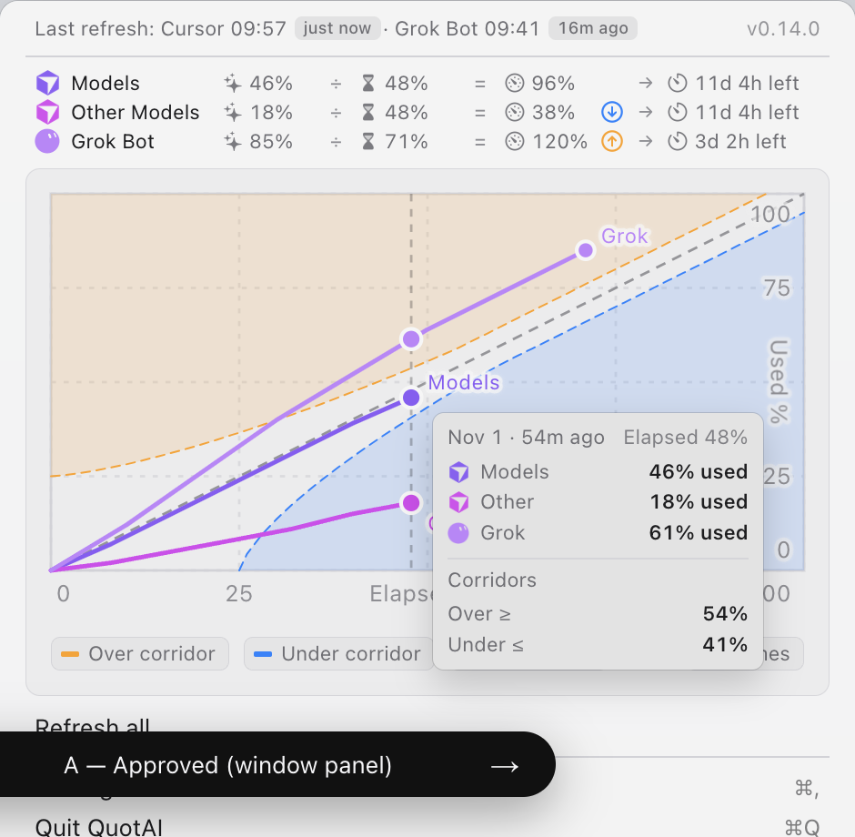
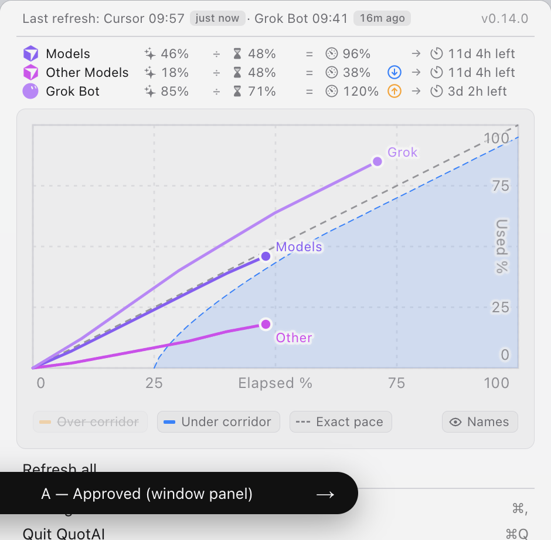

# MenuBarExtra window panel — design

# Approved design — MenuBarExtra window panel (Variant A)

**Status:** Locked visual source of truth (Corridor alerts · scrap on-pace).  
**Prototype:** [`index.html`](index.html) · open with `?variant=A` (default).  
**Tweak clone:** Variant D — nit there; promote D → A to re-lock.  
**Screenshots:** refresh after this promote (see §12).

| File | Captures |
| --- | --- |
| [`approved-panel-A.png`](screenshots/approved-panel-A.png) | Resting panel |
| [`approved-panel-A-hover.png`](screenshots/approved-panel-A-hover.png) | Mid-plot hover tip + guide |
| [`approved-panel-A-filters-off.png`](screenshots/approved-panel-A-filters-off.png) | Over corridor filter off |







Sections below describe **only the currently approved panel** (A). Variants B/C are chrome comparisons and are out of scope for ship UI.

---

## Product model

| Concept | Role |
| --- | --- |
| **Pace** | Neutral fact only: gauge icon + `N%` (always `--secondary`). No on/under/over words or colors. |
| **Corridor alerts** | Under / over / exhausted / quiet from existing alert bands (renamed from “smart pace alerts”). |
| **Meter alert column** | After pace, before `→`: icon when under / over / exhausted; quiet → empty aligned 14px slot. |
| **Chrome** | Tint + blink only from corridor kind (ring/bar in app). Quiet / alerts-off → neutral. |
| **On-pace band** | Removed from chart, legend, tip, meters, Settings Pace tab. |

### Meter formula

`avatar · name · used ÷ elapsed = pace · alert? → reset`

| Slot | Spec |
| --- | --- |
| Pace | `[gauge] 96%` — secondary always |
| Alert · under | `arrow.down.circle` · `#0a84ff` |
| Alert · over | `arrow.up.circle` · `#ff9f0a` |
| Alert · exhausted | `xmark.circle` · `#ff453a` |
| Alert · quiet | `checkmark.circle` · greyed (`--tertiary` @ ~0.7) |

Demo rows: Models quiet · Other under · Grok over.

### Copy

Prefer **Corridor alerts** — avoid “smart” and “on-pace” in approved UI strings.  
Legend: **Over corridor** / **Under corridor**.

---

## 1. Product role

A **MenuBarExtra**-style **window panel** (not a native `.menu`) that combines:

1. Refresh / version chrome  
2. Per-quota **meters** (used ÷ elapsed = pace · alert → time left)  
3. **Pace history chart** — used % (Y) vs elapsed % (X) with corridors + trajectories  
4. Standard actions (Refresh / Settings / Quit)

Native `MenuBarExtraStyle.menu` cannot host Swift Charts; this panel is the approved host.

---

## 2. Overall chrome

| Property | Value |
| --- | --- |
| Width | **~470px** (Variant A/D shell; was 500 in earlier drafts) |
| Background | `rgba(246, 246, 246, 0.92)` light · `rgba(42, 42, 42, 0.94)` dark (`--menu-bg`) |
| Blur | Backdrop blur **~22pt** |
| Corner radius | **10px** |
| Padding (vertical stack) | **5px** top/bottom on the panel shell |
| Shadow | Hairline `0 0 0 0.5px rgba(0,0,0,0.14)` + drop `0 14px 44px rgba(0,0,0,0.24)` |
| Base type | **13px** SF / `-apple-system`; tabular nums on meters & ticks |
| Position (proto stage) | Anchored under menu-bar slot, `right: 8px` of stage |

### Tokens (light / dark)

| Token | Light | Dark | Role |
| --- | --- | --- | --- |
| `--panel` | `#f6f6f6` | `#2a2a2a` | Solid surfaces, tip, chart-well mix base |
| `--text` | `#1d1d1f` | `#f5f5f7` | Primary label (meter names, actions) |
| `--secondary` | `#6e6e73` | `#a1a1a6` | Status line, meter facts, tip labels |
| `--tertiary` | `#8e8e93` | `#8e8e93` | Chart tick numbers & axis titles |
| `--divider` | `#d2d2d7` | `#3a3a3c` | Separators, axis stroke, grid mix |
| `--accent` | `#007aff` | (same) | Menu-bar slot highlight (proto only) |
| `--menu-hover` | `#0a82ff` | (same) | Action row hover fill |
| `--cursor` | `#8b5cf6` | | Models trajectory / avatar tint |
| `--other` | `#d946ef` | | Other Models (fuchsia — not slate) |
| `--grok` | `#c084fc` | | Grok Bot (lavender — not sky) |
| `--even` | `#86868b` / `#98989d` | | Exact-pace diagonal |

**Do not** use blue / green / orange / red / yellow for series (reserved for corridor chrome).

Corridor fills: orange `#ff9f0a`, blue `#0a84ff` (over / under). No on-pace green band.

---

## 3. Vertical stack (top → bottom)

```
┌──────────────────────────────────────────── panel ──┐
│  [status row]                                       │
│  ── sep ──                                          │
│  [meters grid · 3 rows]                             │
│  [chart-well: plot + legend]                        │
│  [Refresh all]                                      │
│  ── sep ──                                          │
│  [Settings…          ⌘,]                            │
│  [Quit QuotAI        ⌘Q]                            │
└─────────────────────────────────────────────────────┘
```

### Separators

- Height **1px**, color `--divider`
- Margin **`5px 14px`** (matches chart-well horizontal inset language)

### Shared row geometry (status + actions)

| Property | Value |
| --- | --- |
| Min height | **22px** |
| Padding | **`2px 14px`** |
| Horizontal margin | **`0 5px`** |
| Corner radius (hover) | **4px** |

---

## 4. Status row

- Style: `.row.secondary` — **12px** (A/D denser **11px**), `--secondary`, space-between  
- **Left:** `Last refresh: Cursor HH:MM` + ago badge · `Grok Bot HH:MM` + ago badge  
- **Right:** app version (`v0.14.0`), opacity **0.72**, tabular nums  

### Ago badges

| Property | Value |
| --- | --- |
| Padding | `0 5px` |
| Radius | **4px** |
| Background | `color-mix(text 8%, transparent)` |
| Type | **10px** / weight **500** / `--secondary` |
| Margin | `0 1px 0 4px` from preceding time |

---

## 5. Meters grid

Three quota rows × formula columns:

`avatar · name · used ÷ elapsed = pace · alert → reset`

### Grid

```
columns: 14px | minmax(max-content, 1fr) | max-content × formula … | 14px alert | → | reset
column-gap: 6px
row-gap: 2px
padding: 2px 14px 4px
margin: 0 5px
```

Name column grows so **used → reset** sits flush right.

### Cells

| Element | Spec |
| --- | --- |
| Avatar | **14×14** series-colored **mask** tint (black body → series hex; cutouts clear). No opacity-dim for Other. |
| Name | Primary text, nowrap; flexes left |
| Fact (used / elapsed / pace / reset) | **11–12px**, `--secondary`, gap **3px** icon↔value, tabular; formula block right-aligned |
| Operators `÷` `=` `→` | **11px**, weight **500**, `#8e8e93`, centered |
| Metric icons (`.sf`) | **12×12** mask PNGs; fill **`--secondary` @ 0.9** |
| Pace fact | Always `--secondary`; `N%` only (no under/over/on-pace words) |
| Alert slot | **14×14**; quiet grey checkmark; under / over / exhausted as above |

### SF Symbol intents (prod)

| Slot | Prototype mask | Intended SF Symbol |
| --- | --- | --- |
| Used | `sf/used.png` | `sparkles` |
| Elapsed | `sf/elapsed.png` | `hourglass.bottomhalf.filled` |
| Pace | `sf/pace.png` | `gauge.with.dots.needle.67percent` |
| Reset | `sf/reset.png` | `timer` |
| Alert under | SVG | `arrow.down.circle` |
| Alert over | SVG | `arrow.up.circle` |
| Alert exhausted | — | `xmark.circle` |

Copy pattern examples: `46%` · `48%` · `96%` · (empty alert) · `11d 4h left`.

---

## 6. Chart well

Nested “card” around the plot — **not** a floating white card over the panel; a slightly lifted inset.

| Property | Value |
| --- | --- |
| Margin | **`4px 14px 6px`** |
| Padding | **14px** all sides |
| Radius | **8px** |
| Background | `color-mix(in srgb, var(--text) 4.5%, var(--panel))` |
| Hairline | inset `0 0 0 0.5px` of `divider @ 80%` |

Inside well:

1. Chart host (SVG, width 100%)  
2. Legend (margin-top **6px** in markup)

---

## 7. Chart geometry (approved inset chrome)

### ViewBox model

| Constant | Panel value | Notes |
| --- | --- | --- |
| `plotH` | **148** | SVG user units |
| `plotW` | **`plotH × 2` = 296** | Intentional 2:1 elapsed:used aspect |
| `padL` / `padT` / `padR` | **0** | Plot flush; well padding is the only outer clearance |
| `padB` | **22** | Room for X tick baseline under the plot |
| Axes | X = elapsed % 0…100 · Y = used % 0…100 | Origin bottom-left of plot |

### Layers (paint order)

1. Grid (dashed)  
2. Axis rectangle stroke  
3. Bands: over → under → even diagonal (**no on-pace**)  
4. Series paths + end dots  
5. Series name annotations (when Names on)  
6. Axis chrome (ticks / titles) — **above** fills  
7. Hover guide + hover dots  
8. Invisible hit rect (full plot)

### Grid & axis

| Element | Spec |
| --- | --- |
| Tick set | **0, 25, 50, 75, 100** (both axes) |
| Grid stroke | `divider @ 70%`, width **1**, dash **`2 3`** |
| Axis rect | stroke `--divider`, width **1**, fill none |
| Tick type | **9px**, fill `--tertiary`, system font |

### Approved axis chrome (inset)

**X axis (bottom of plot):**

- Baseline Y = `plotH + 12`  
- Numbers at 0 / 25 / 75 / 100; **`50` replaced by title `Elapsed %`**  
- Edge nudges: **`0` → +5** right; **`100` → −13** left  

**Y axis (inside right spine):**

- Tick X = `plotW − 5`, `text-anchor: end`  
- Numbers 0 / 25 / 75 / 100; **`50` replaced by `Used %`**  
- `Used %`: rotate **90°**; X = `plotW − 5 − 8`; Y = mid (`y(50)`)  
- Vertical nudges: **`0` → −8**; **`100` → +8**  
- Y ticks over fills use class **`.inset`**: soft translucent halo  

### Corridors & reference

| Layer | Fill | Edge / line |
| --- | --- | --- |
| Over corridor | `#ff9f0a` @ **16%** | Boundary `#ff9f0a`, width **0.7**, dash `3.5 2.5` |
| Under corridor | `#0a84ff` @ **16%** | Boundary `#0a84ff`, width **0.7**, dash `3.5 2.5` |
| Exact pace | — | `--even`, width **1**, dash **`4 3`**, opacity **0.85** |

**Corridor math:** match app `PaceAlertThresholds` (proto defaults):

| Key | Default |
| --- | --- |
| `overMaxStartPct` | 25 |
| `overEmptyBeforePct` | 95 |
| `underAfterPct` | 25 |
| `underMinEndPct` | 95 |
| `overCurvePct` / `underCurvePct` | 40 |

Sample stride **0.02** in elapsed fraction.

### Trajectories

| Series | Stroke | End dot |
| --- | --- | --- |
| Models (Cursor) | `--cursor` `#8b5cf6` | r **3.5**, stroke `--panel` **1.5** |
| Other Models | `--other` `#d946ef` | same |
| Grok Bot | `--grok` `#c084fc` | same |

- Path stroke width **1.75**, round caps/joins  
- End labels: **Models** / **Other** / **Grok**, series-colored, ~8pt, halo; nudge when Models/Other share elapsed %  
- Toggle via legend **Names** (eye / eye-slash)

### Hover

| Element | Spec |
| --- | --- |
| Hit target | Full plot rect |
| Guide | Vertical dashed line, `--text` @ 28%, dash `3 3` |
| Hover dots | r **4**, panel stroke 1.5 |
| Tip | Min width 118; pad `6px 8px`; radius **6**; bg `panel 92% + black`; hairline + soft shadow; **11px** |
| Tip content | When (date · ago · Elapsed n%) → per-series used % with **series-tinted** avatars → **Corridors** (over ≥ / under ≤) — no on-pace row |

---

## 8. Legend (plot filters)

Row of compact toggles under the SVG (`aria-pressed`).

| Property | Value |
| --- | --- |
| Layout | Flex wrap, gap **`6px 8px`**; **Names** right-aligned (`margin-left: auto`) |
| Type | **11px**, `--secondary` |
| Chip | Pad `2px 7px 2px 5px`, radius **5**, hairline border, bg `text @ 3.5%` |
| Off state | Opacity **0.38** + line-through |
| Swatches | Over/under 10×3 bars; exact = dashed top border 12 wide; Names = eye icon |

Default: Over / Under / Exact / Names **on**. No on-pace chip.

---

## 9. Actions

| Row | Trailing |
| --- | --- |
| Refresh all | — |
| Settings… | `⌘,` |
| Quit QuotAI | `⌘Q` |

Hover: fill `--menu-hover`, text white (including kbd).

Order: Refresh → sep → Settings → Quit.

---

## 10. Interaction & accessibility notes

- Panel `role="dialog"`; meters `role="table"`; legend `role="group"`  
- Chart `role="img"` with concise aria-label  
- Filter buttons expose `aria-pressed`  
- Plot cursor: crosshair  
- Tabular figures everywhere numeric  

---

## 11. Swift mapping hints (non-binding)

| Proto | Likely Swift |
| --- | --- |
| `.panel-window` | `MenuBarExtra` + `.menuBarExtraStyle(.window)` / custom panel |
| Meters grid | Manual rows + alert column from `PaceAlertBands` |
| Chart | Swift Charts; layers over / under / even / names — no on-pace |
| Avatar mask | Template/mask tint like `BarIcon` / `RingIcon` |
| Series colors | Fixed hex map in QuotAICore |
| Corridor chrome | `PaceChromeResolver` — tint/blink from corridor kind only |

Do **not** treat B (popover) or C (detached) as ship targets unless a later decision reopens chrome.

---

## 12. Source of truth & change control

1. **Visual:** Variant **A** in the HTML prototype + this doc + screenshot(s).  
2. **Nits:** Edit **D** only; when accepted, promote into A and re-clone D.  
3. **Implementation:** Prefer matching measured tokens above over reinventing spacing.  
4. If screenshot and CSS disagree, **CSS/JS in `index.html` wins** — update this doc in the same change.

### Screenshots on file

- [x] `approved-panel-A.png` — resting panel (Corridor promote)  
- [x] `approved-panel-A-hover.png` — crosshair tip mid-plot (Corridors block, no on-pace)  
- [x] `approved-panel-A-filters-off.png` — Over corridor toggled off  

Dark-mode capture skipped for now.

---

## 13. Checklist for implementation parity

- [ ] Panel ~470pt wide, 10pt corners, translucent material + shadow  
- [ ] Status + meters + chart-well + actions stack with 14pt horizontal rhythm  
- [ ] Meter formula + neutral pace + alert slot + series-tinted avatars  
- [ ] Chart-well 14pt pad, 8pt radius, subtle fill vs panel  
- [ ] Plot 2:1, flush L/T/R, bottom ticks; inset Y ticks; mid titles replace 50  
- [ ] Corridors + even diagonal + three series + end dots + Names labels  
- [ ] Legend chips (no on-pace); Names eye toggle  
- [ ] Hover tip: Corridors title; no on-pace row; series-tinted swatches  
- [ ] Light + dark token sets  
