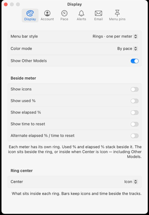
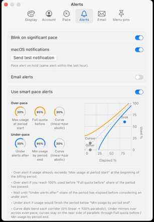
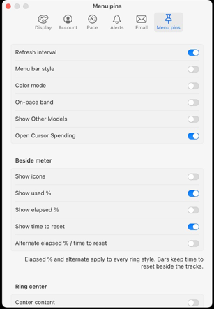

#  QuotAI 

macOS menu-bar app for Cursor Spending quota: Cursor Models, Other, and Grok Bot. Pace shows as rings and blinks.

## Install

**[Download QuotAI-0.20.0.dmg](https://github.com/marotron/QuotAI/releases/download/v0.20.0/QuotAI-0.20.0.dmg)** · [latest release](https://github.com/marotron/QuotAI/releases/latest)

1. Open the disk image (install steps are on the window background).
2. Drag **QuotAI** → **Applications**, then double-click **Open QuotAI** (or open it from Applications). It lives in the menu bar.
3. When Keychain asks for your login password, enter it and press **Always Allow** so QuotAI can read encrypted API keys without prompting every launch.
4. If Gatekeeper blocks the first open, use System Settings → Privacy & Security → **Open Anyway** (optional; skip when the app launches fine).

The 0.20.0 build is ad-hoc signed (hardened runtime off) unless the release was notarized.

## Screenshots

Menu bar rings show used % and time to reset. Nested Cursor blinks between Models and Other; a smart pace hit blinks that quota ring. ([Original recording](docs/screenshots/menu-rings.mov).)


Settings → Display sets ring style, beside-meter labels, and ring center:



Settings → Alerts draws the smart pace corridors:



Settings → Menu pins which rows stay on the menu, including Open Cursor Spending:



## Features

- **Window panel** in the menu bar: meters (used ÷ elapsed = pace · corridor alert → reset), pace history chart, and actions (Refresh / Settings / About / Quit). Click the header version for the in-app changelog.
- **Pace history** shows two-decimal hover readings and translucent markers; zoomed lines track the underlying readings and hover values.
- **Optional Cursor discrepancy detection** compares local activity with quota changes and selectively checks detailed billing records for unmatched activity, excluding confirmed Free and custom-key requests. Billing lookups are bounded, cached, and run in the background.
- **Rings** for used % and time to reset: one meter each, nested Cursor (Models + Other), or pace segments.
- **Nested Cursor** blinks between Models and Other. A corridor alert blinks the quota ring that crossed the band; under paints blue and over paints orange ([pace chrome order](docs/pace-chrome.md)).
- **Automatic refresh** supports optional quiet hours, a wake refresh switch, and configurable high-usage rules for Cursor and Grok Bot. Manual refresh and opening a stale panel remain available during quiet hours.
- **Dynamic refresh** applies one shared schedule independently to Cursor and Grok Bot from each family’s time to reset (fixed interval still refreshes both together). Menu and Settings show `Last refresh: Cursor … · Grok Bot …` (24-hour) with Refresh all / Cursor / Grok Bot.
- **Corridor alerts** use under/over/exhausted bands for blink / notification / email; quiet stays neutral ([pace chrome](docs/pace-chrome.md)).
- **Open Cursor Spending** opens [cursor.com/dashboard/spending](https://cursor.com/dashboard/spending) from the panel.
- **Settings** separate Account from Refresh, with tabs for display, alerts, email, and menu pins. Refresh contains cadence, manual actions, and automatic refresh rules; Account contains Cursor authentication and activity diagnostics. Settings → Menu pins also sets the dropdown layout: `Compact` (smaller text, pinned rows in two columns) or `Normal` (regular text, one column).
- **About** shows version, short commit SHA, in-app changelog, and a link to GitHub release notes.

## Requirements

macOS 14 or later. Cursor must be signed in on this Mac, or paste a token under Settings → Account.

## Troubleshooting

- **Empty meters.** Sign in to Cursor, then choose **Refresh** on the QuotAI menu. Or Settings → Account → **Re-auth from Cursor**.
- **Auth error.** The menu says “Auth error — re-auth or paste token”. Use **Re-auth from Cursor** or **Paste token…**. Tokens stay in Keychain.
- **Refresh failed.** The menu keeps the last meters and shows the error (offline, timeout, or HTTP). **Refresh** again when the network is back. A sign-in failure replaces the menu-bar icon until you re-auth.

## Build

For contributors:

```bash
make project   # xcodegen generate
make test      # QuotAICore unit tests
open QuotAI.xcodeproj
```

The app is `QuotAI/` and `QuotAICore/`. Paths under `.scratch/` are not part of the build.

**Specifications:** [product behavior](docs/pr.md), [technical architecture](docs/tech-specs.md), and [Cursor activity diagnostics](docs/cursor-discrepancies.md). Update the relevant specs alongside behavior changes.

**CI:** pull requests and pushes to `main` run `make test` on GitHub Actions ([workflow](.github/workflows/ci.yml)). Full where/when map: [`docs/agents/ci-cd.md`](docs/agents/ci-cd.md).

## Release

**Versioning (0.x):** QuotAI uses SemVer (`MAJOR.MINOR.PATCH`). While the app is `0.x`, a breaking change bumps **MINOR** (e.g. `0.17.2` → `0.18.0`) and is listed under `### Breaking` in `CHANGELOG.md`.

Development uses `X.Y.Z-rc.N` candidates. Each product/test/Unreleased update increments RC and build together; About and the panel show the candidate label. Notes stay under Unreleased and public download links stay on the shipped version. Shipping clears the candidate to zero, increments build, promotes the notes, and updates the relevant README claims. See [versioning](.cursor/rules/versioning.mdc).

```bash
make dmg        # package only → dist/QuotAI-<version>.dmg
make release    # run tests, then package
```

**GitHub Release:** push a **signed** tag `vX.Y.Z` matching `MARKETING_VERSION` (e.g. `v0.13.0` for `0.13.0`). The [Release workflow](.github/workflows/release.yml) runs `make test`, builds the DMG, publishes **QuotAI X.Y.Z**, and attaches the disk image. Notes come from `CHANGELOG.md` plus [`.github/RELEASE_BODY.md`](.github/RELEASE_BODY.md). Optional repo secrets: `QUOTAI_SIGN_IDENTITY`, `QUOTAI_NOTARY_PROFILE`. Details: [`docs/agents/ci-cd.md`](docs/agents/ci-cd.md).


GitHub shows **Verified** only for cryptographically signed tags — never use a lightweight `git tag v…` or an unsigned annotated tag for ships.

```bash
git tag -s v0.13.0 -m "0.13.0"   # signed annotated tag → GitHub Verified
git verify-tag v0.13.0            # must succeed before push
git push origin v0.13.0
```

If global signing config is unset, one-shot:

```bash
ssh-add --apple-use-keychain ~/.ssh/id_ed25519_github
git -c gpg.format=ssh -c user.signingkey="$HOME/.ssh/id_ed25519_github" tag -s v0.13.0 -m "0.13.0"
```

Optional local ship (same as CI), once a Developer ID certificate and a notary keychain profile exist:

```bash
export QUOTAI_SIGN_IDENTITY='Developer ID Application: …'
export QUOTAI_NOTARY_PROFILE='quotai-notary'
make dmg
```

Without those, the DMG is ad-hoc signed. If Gatekeeper blocks the first open, use System Settings → Privacy & Security → **Open Anyway** (or right-click QuotAI → Open).

## License

[MIT](LICENSE)
