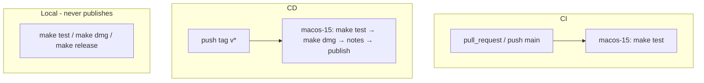

# QuotAI CI/CD

Where and when tests run, and how a GitHub Release is created for this repo.

**Stack on runners:** macOS 15, XcodeGen, Swift 5.10, deployment target macOS 14 (`project.yml`).

## Overview

| Path | Trigger | Where | What |
|------|---------|-------|------|
| **CI** | `pull_request`, `push` to `main` | GitHub Actions `macos-15` | `make test` |
| **CD** | push tag `v*` | GitHub Actions `macos-15` | `make test` → `make dmg` → notes → GitHub Release + DMG |
| **Local** | you run Make | your Mac | `make test` / `make dmg` / `make release` (no GitHub Release) |

Workflows: [`.github/workflows/ci.yml`](../../.github/workflows/ci.yml), [`.github/workflows/release.yml`](../../.github/workflows/release.yml).



## Continuous integration (testing)

### When / where

| Event | Where | Runs `make test`? |
|-------|-------|-------------------|
| While coding | your Mac | only if you run `make test` |
| Open or update a PR | Actions `macos-15` | yes ([`ci.yml`](../../.github/workflows/ci.yml)) |
| Push to `main` | Actions `macos-15` | yes |
| Push ship tag `vX.Y.Z` | Release job | yes (before DMG) |
| Local `make dmg` | your Mac | no |
| Local `make release` | your Mac | yes locally; does **not** create a GitHub Release |

### What `make test` is

`xcodegen generate`, then `xcodebuild test -scheme QuotAI -destination 'platform=macOS'`.

CI installs XcodeGen with Homebrew (same untap guard as Release), then runs `make test`. In-progress runs for the same ref are cancelled (`concurrency`).

## Continuous delivery (GitHub Release)

A GitHub Release is created **only** by the Release workflow after a matching tag is pushed. Merging a PR, pushing `main`, or local `make dmg` / `make release` never publishes.

### Human steps (before Actions)

1. On a `feat/…` / `fix/…` / `hotfix/…` branch: bump `MARKETING_VERSION` + `CURRENT_PROJECT_VERSION` in `project.yml`, regenerate the Xcode project, add a `CHANGELOG.md` section, update README download links. Commit only after confirm (see `.cursor/rules/versioning.mdc`).
2. Merge to `main`.
3. On the ship commit, create a **signed** annotated tag matching `MARKETING_VERSION`, verify, push:

```bash
git tag -s v0.11.0 -m "0.11.0"
git verify-tag v0.11.0
git push origin v0.11.0
```

Tag must be `v` + semver equal to `MARKETING_VERSION`. `Scripts/release/dmg.sh` fails if `RELEASE_TAG` and `project.yml` disagree. Unsigned / lightweight tags are not ship tags (GitHub Verified needs a signed tag).

### Runner steps (after tag push)

1. Checkout (`fetch-depth: 0`).
2. Install XcodeGen.
3. **`make test`**
4. **`make dmg`** with `RELEASE_TAG` set → `dist/QuotAI-<version>.dmg`  
   Optional secrets: `QUOTAI_SIGN_IDENTITY`, `QUOTAI_NOTARY_PROFILE` (otherwise ad-hoc sign).
5. **`Scripts/release/notes.sh`** → `dist/RELEASE_NOTES.md` (CHANGELOG section + [`.github/RELEASE_BODY.md`](../../.github/RELEASE_BODY.md)).
6. **`softprops/action-gh-release`** — full release titled **`QuotAI X.Y.Z`**, attach DMG, `prerelease: false`.

### Local packaging (no publish)

```bash
make dmg        # package only
make release    # test then package → dist/QuotAI-<version>.dmg
```

Optional signing locally:

```bash
export QUOTAI_SIGN_IDENTITY='Developer ID Application: …'
export QUOTAI_NOTARY_PROFILE='quotai-notary'
make dmg
```

## Do not

- Expect a GitHub Release from a PR merge or `main` push without a `v*` tag
- Ship with a lightweight or unsigned tag
- Assume notarization without repo secrets / local notary profile
- Put version bumps for CI/docs-only work (docs/chore → no SemVer bump)

## Related

- Contributor summary: [README.md](../../README.md) Build / Release
- Versioning / signed tags: [AGENTS.md](../../AGENTS.md), `.cursor/rules/versioning.mdc`
