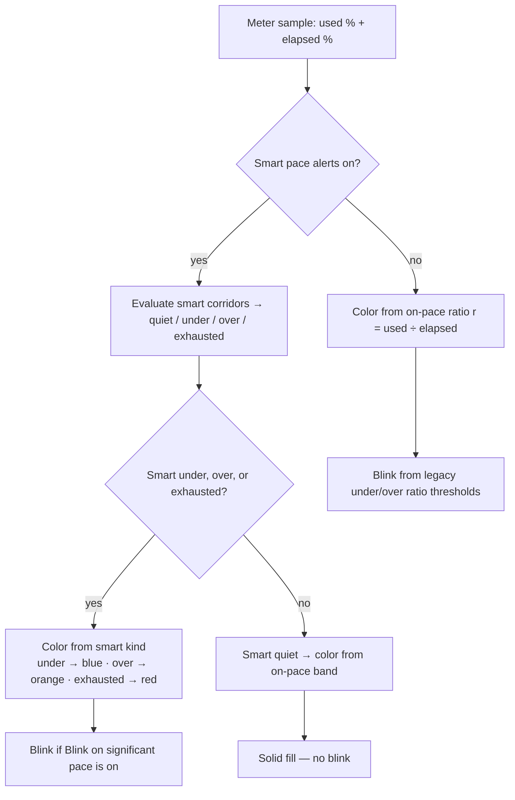

# Pace chrome (ring / bar color + blink)

How QuotAI picks **fill color** and **blink** for each quota meter when **Use smart pace alerts** is on and color mode is by level.

**Code:** `PaceChromeResolver` in QuotAICore · tests: `PaceChromeTests`  
**Settings:** Pace (on-pace band) · Alerts (smart corridors + blink toggle)

## Definitions

| Term | Meaning |
|------|---------|
| **Pace ratio** `r` | `used % ÷ elapsed %` of the billing period. Settings → Pace “on-pace band” (e.g. 85–115%) is a dead zone around `r = 1`. |
| **On-pace: normal** | `r` inside that band → green when smart is quiet. |
| **On-pace: under / over** | `r` below / above the band → blue / orange when smart is quiet. |
| **Smart: quiet** | No corridor alert — usage sits between the under and over lines on the Alerts chart (grey dot). Same idea as “normal” in the matrix below. |
| **Smart: under** | Below the under-pace corridor (after “Under alerts after”) → projected to finish the period too low. |
| **Smart: over** | Above the over-pace corridor → burning too fast / heading to empty too early. |
| **Smart: exhausted** | That meter’s **used % ≥ 100%** (quota empty). Checked before under/over. |
| **Significant** | Smart kind is under, over, or exhausted (not quiet) → may blink / notify / email. |
| **Solid vs blink** | Solid = steady fill. Blink = fill pulses when significant *and* “Blink on significant pace” is on. |

## Decision order

**Short rule**

1. If smart fires **under / over / exhausted** → that color wins, and the ring may **blink**.
2. If smart is **quiet** → **on-pace band** sets solid green / blue / orange (no blink from smart).
3. If smart alerts are **off** → color and blink both use pace ratio thresholds (legacy).

Menu row labels still use pace ratio `r = used ÷ elapsed` (Settings → Pace). Notify / email use the same smart significance, with a cooldown — separate from live blink.

## Scenario matrix

| # | On-pace band | Smart alert | Chrome |
|---|--------------|-------------|--------|
| 1 | under | quiet | blue solid |
| 2 | over | over | orange blink |
| 3 | normal | under | blue blink |
| 4 | normal | quiet | green solid |
| 5 | over | under | **smart wins** → blue blink |
| 6 | under | over | **smart wins** → orange blink |
| 7 | normal | over | orange blink |
| 8 | over | quiet | orange solid |

Example: Other at ~90% pace ratio (inside 85–115%) but below the under corridor → **#3** → blue blink.
