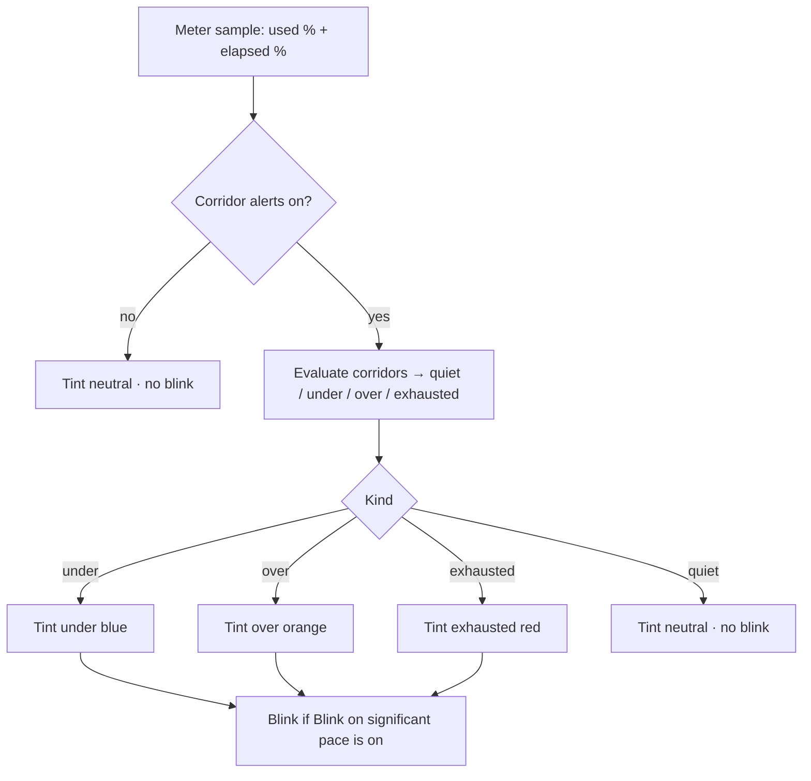

# Pace chrome (ring / bar color + blink)

How QuotAI picks **fill color** and **blink** for each quota meter when color mode is by level.

**Code:** `PaceChromeResolver` in QuotAICore · tests: `PaceChromeTests`  
**Settings:** Alerts (corridor alerts + blink toggle)

## Definitions

| Term | Meaning |
|------|---------|
| **Corridor alerts** | Under / over / exhausted / quiet from `PaceAlertBands` (same corridors as the pace history chart). |
| **Quiet** | No corridor alert — usage sits between the under and over lines. |
| **Under** | Below the under-pace corridor (after “Under alerts after”) → projected to finish the period too low. |
| **Over** | Above the over-pace corridor → burning too fast / heading to empty too early. |
| **Exhausted** | That meter’s **used % ≥ 100%** (quota empty). Checked before under/over. |
| **Significant** | Corridor kind is under, over, or exhausted (not quiet) → may blink / notify / email. |
| **Solid vs blink** | Solid = steady fill. Blink = fill pulses when significant *and* “Blink on significant pace” is on. |

## Decision order

**Short rule**

1. Corridor alerts **off** → always **neutral** (no ratio fallback).
2. Corridor **quiet** → **neutral**, solid.
3. Corridor **under / over / exhausted** → that color; **blink** if the blink toggle is on.

Panel meter pace text is always neutral `N%` (no under/over/on-pace words). Notify / email use the same corridor significance, with a cooldown — separate from live blink.

## Scenario matrix

| # | Corridor alerts | Corridor kind | Chrome |
|---|-------------|----------------|--------|
| 1 | on | quiet | neutral solid |
| 2 | on | under | blue blink |
| 3 | on | over | orange blink |
| 4 | on | exhausted | red blink |
| 5 | off | any | neutral solid |
| 6 | on | under, blink off | blue solid |
